<!-- VISUAL-LIBRARY-GALLERY:START -->

**7611 条资料 · 13 个分类 · 22 个模板**

[打开完整画廊](docs/gallery.md) · [提示词模板](docs/templates.md)

原图文案例 7178 · 风格参考 9 · 关键词资料 418 · 图片参考 6。待复核 7058；缺少必要输入图 7。

[按模型浏览](docs/models/index.md) · [艺术家、流派与材质](docs/topics/index.md) · [复核说明](docs/collection-status.md) · [PDF关键词补遗](docs/pdf-keywords.md)

### 分类浏览

<table>
<tr>
<td width="33%" align="center" valign="top"> <a href="docs/categories/cat-ui.md"><strong>UI 与界面</strong></a> 73 条资料 App、网页、仪表盘、社媒截图与产品界面。</td>
<td width="33%" align="center" valign="top"><a href="docs/categories/cat-infographic.md">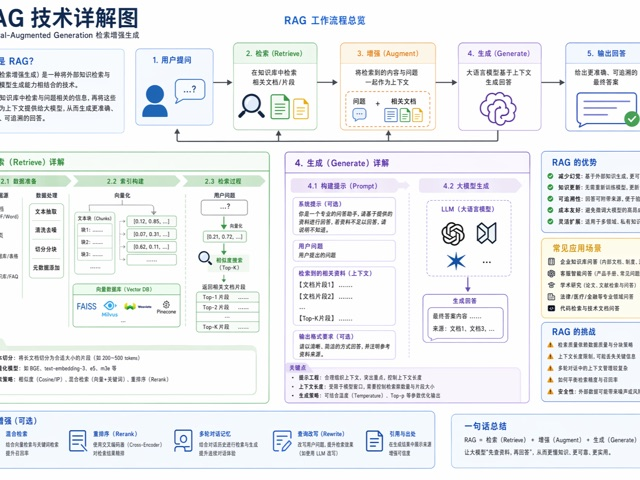</a> <a href="docs/categories/cat-infographic.md"><strong>图表与信息可视化</strong></a> 53 条资料 信息图、知识图谱、技术解释与结构化图解。</td>
<td width="33%" align="center" valign="top"><a href="docs/categories/cat-poster.md">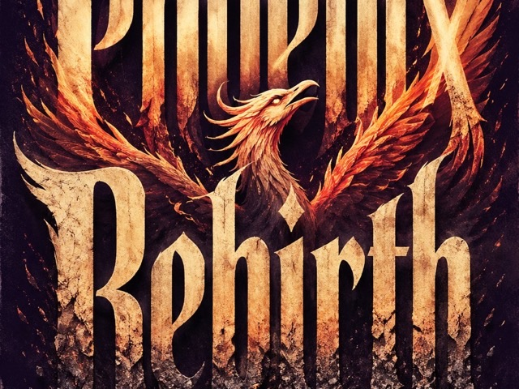</a> <a href="docs/categories/cat-poster.md"><strong>海报与排版</strong></a> 90 条资料 活动海报、封面、字体视觉和强排版画面。</td>
</tr>
<tr>
<td width="33%" align="center" valign="top"> <a href="docs/categories/cat-product.md"><strong>商品与电商</strong></a> 44 条资料 商品图、详情页、包装卖点和商业广告。</td>
<td width="33%" align="center" valign="top"><a href="docs/categories/cat-brand.md">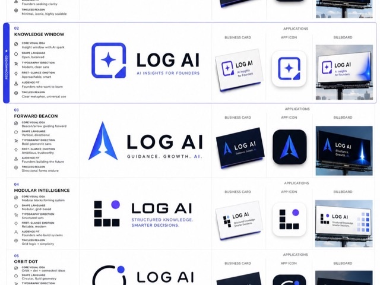</a> <a href="docs/categories/cat-brand.md"><strong>品牌与标志</strong></a> 27 条资料 Logo、VI、品牌触点和 Campaign 视觉系统。</td>
<td width="33%" align="center" valign="top"><a href="docs/categories/cat-architecture.md">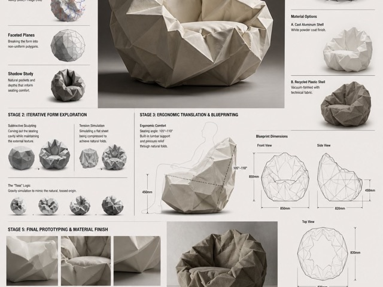</a> <a href="docs/categories/cat-architecture.md"><strong>建筑与空间</strong></a> 12 条资料 建筑表现、室内空间、城市地图和空间概念。</td>
</tr>
<tr>
<td width="33%" align="center" valign="top"><a href="docs/categories/cat-photo.md">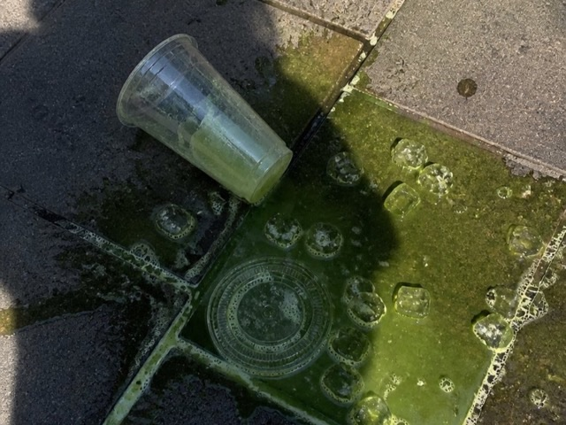</a> <a href="docs/categories/cat-photo.md"><strong>摄影与写实</strong></a> 77 条资料 人像、手机纪实、胶片质感和商业摄影。</td>
<td width="33%" align="center" valign="top"><a href="docs/categories/cat-illustration.md">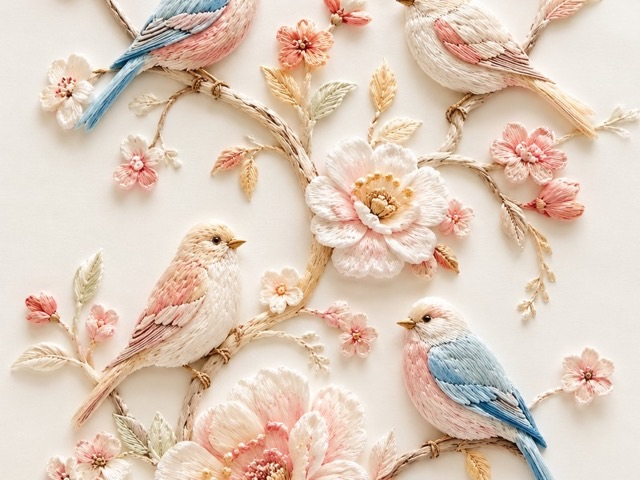</a> <a href="docs/categories/cat-illustration.md"><strong>插画与艺术</strong></a> 79 条资料 插画、艺术风格、材质实验和装饰画面。</td>
<td width="33%" align="center" valign="top"> <a href="docs/categories/cat-character.md"><strong>人物与角色</strong></a> 37 条资料 角色设定、动作参考、卡牌和 3D 玩具。</td>
</tr>
<tr>
<td width="33%" align="center" valign="top"> <a href="docs/categories/cat-scene.md"><strong>场景与叙事</strong></a> 22 条资料 分镜、故事场景、直播画面和世界观叙事。</td>
<td width="33%" align="center" valign="top"><a href="docs/categories/cat-history.md">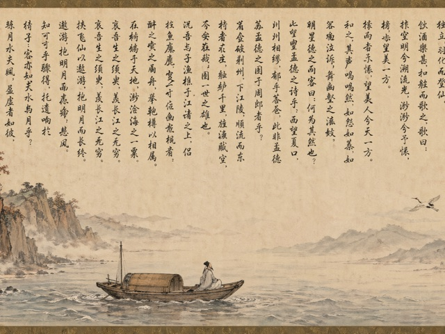</a> <a href="docs/categories/cat-history.md"><strong>历史与古风题材</strong></a> 16 条资料 古风长卷、历史人物、传统题材和诗词画面。</td>
<td width="33%" align="center" valign="top"><a href="docs/categories/cat-document.md">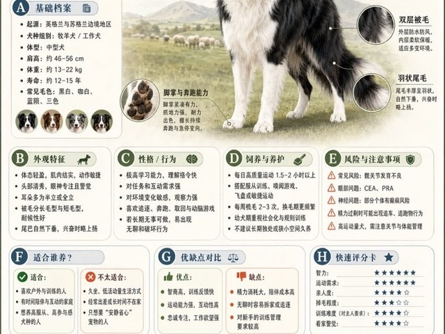</a> <a href="docs/categories/cat-document.md"><strong>文档与出版物</strong></a> 11 条资料 白皮书、手册、百科图鉴和出版页设计。</td>
</tr>
<tr>
<td width="33%" align="center" valign="top"><a href="docs/categories/cat-other.md">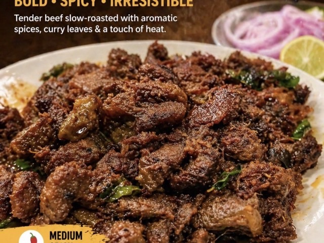</a> <a href="docs/categories/cat-other.md"><strong>其他应用场景</strong></a> 7070 条资料 创意实验、特殊任务、混合玩法和实用场景。</td>
<td width="33%" align="center" valign="top"></td>
<td width="33%" align="center" valign="top"></td>
</tr>
</table>

### 最近收录

<table>
<tr>
<td width="33%" align="center" valign="top"> <a href="cases/case-face-references-commons-tony-leung-photo-b1ac890bf1b0/v1.md"><strong>梁朝伟 来源照片 · v1</strong></a> case-face-references-commons-tony-leung-photo-b1ac890bf1b0 图片参考 · unknown 已记录补充核查结果；以详情中的输入要求为准</td>
<td width="33%" align="center" valign="top"><a href="cases/case-face-references-commons-tony-leung-line-adf2120829bd/v1.md">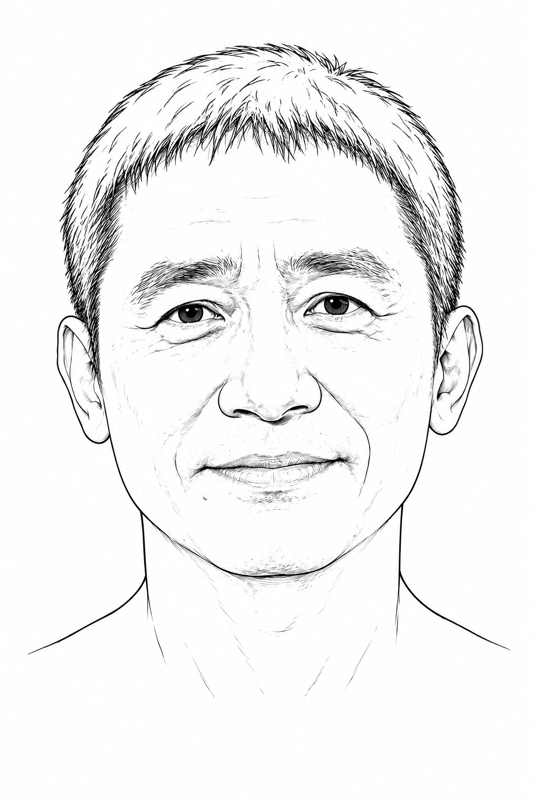</a> <a href="cases/case-face-references-commons-tony-leung-line-adf2120829bd/v1.md"><strong>梁朝伟 面貌线稿｜成熟男性，浓眉、窄长眼裂、较宽鼻翼、舒展嘴宽、偏薄上唇和较宽下颌；眼下与鼻唇沟纹理线偏多。 · v1</strong></a> case-face-references-commons-tony-leung-line-adf2120829bd 图片参考 · unknown 已记录补充核查结果；以详情中的输入要求为准</td>
<td width="33%" align="center" valign="top"> <a href="cases/case-face-references-commons-gong-li-photo-12316cd82442/v1.md"><strong>巩俐 来源照片 · v1</strong></a> case-face-references-commons-gong-li-photo-12316cd82442 图片参考 · unknown 已记录补充核查结果；以详情中的输入要求为准</td>
</tr>
<tr>
<td width="33%" align="center" valign="top"> <a href="cases/case-face-references-commons-gong-li-line-9e210fce53ab/v1.md"><strong>巩俐 面貌线稿｜颧侧较宽、饱满面颊、舒展下颌，细长眼裂，鼻翼舒展、唇形饱满；长发轮廓及脸侧小痣保留。 · v1</strong></a> case-face-references-commons-gong-li-line-9e210fce53ab 图片参考 · unknown 已记录补充核查结果；以详情中的输入要求为准</td>
<td width="33%" align="center" valign="top"><a href="cases/case-face-references-commons-fan-bingbing-photo-946c0f218ee6/v1.md">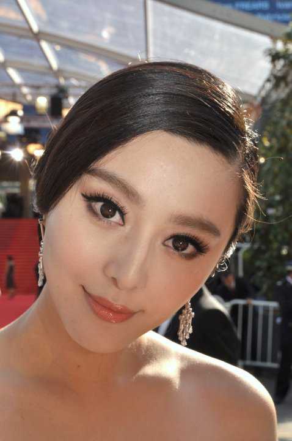</a> <a href="cases/case-face-references-commons-fan-bingbing-photo-946c0f218ee6/v1.md"><strong>范冰冰 来源照片 · v1</strong></a> case-face-references-commons-fan-bingbing-photo-946c0f218ee6 图片参考 · unknown 已记录补充核查结果；以详情中的输入要求为准</td>
<td width="33%" align="center" valign="top"><a href="cases/case-face-references-commons-fan-bingbing-line-c7f864849bf5/v1.md">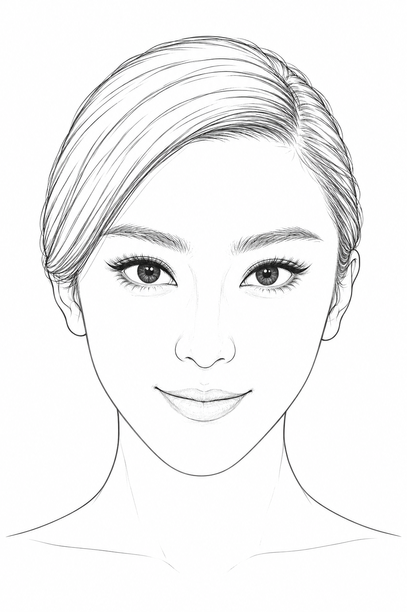</a> <a href="cases/case-face-references-commons-fan-bingbing-line-c7f864849bf5/v1.md"><strong>范冰冰 面貌线稿｜上半脸舒展、下颌收束、小下巴，较大杏仁眼，小鼻尖，清楚唇弓；侧分发型线仍较多。 · v1</strong></a> case-face-references-commons-fan-bingbing-line-c7f864849bf5 图片参考 · unknown 已记录补充核查结果；以详情中的输入要求为准</td>
</tr>
</table>

<!-- VISUAL-LIBRARY-GALLERY:END -->

## 使用资料库

你可以直接看图挑选，也可以把仓库链接交给 Codex，让它读取项目说明后查找资料。每个案例保留图片、完整提示词、版本和原始来源；公众号外链案例保留受控图片链接，MCP 使用时按需读取，不在本地快照持久保存图片二进制。

<strong>让 Codex 帮我找参考</strong>

阅读这个仓库的 README 和 AGENTS.md，帮我找几张复古暖色人像参考。展示候选图片、案例编号和版本，需要时提供完整提示词。

<strong>检索、收藏和更新说明</strong>

- [查看完整使用说明](docs/usage.md)
- [Codex 项目规则](AGENTS.md)
- [查看同步任务](https://github.com/yangchengwu2024/visual-library/actions/workflows/sync.yml)

本地图片型资料和提示词保存在本仓库；公众号外链型资料保存原始提示词、来源和受控图片链接。定时同步追加新资料，保留旧版本和个人记录；普通上游删除不会自动删除本库内容。

## 来源

资料主要来自 [awesome-gpt-image-2](https://github.com/freestylefly/awesome-gpt-image-2) 和用户选中的 [AIArtWorks 微信公众号](https://mp.weixin.qq.com/s/WOi2W6mw41kkaORyj8sVkw)，保留作者与来源信息。公众号图片采用受控外链并标记复核状态；使用范围见 [第三方内容说明](THIRD_PARTY.md)。

## Codex MCP入口

已提供自有只读MCP：查案例、读指定版本、查看图片、查分类与模板。[连接与使用说明](docs/mcp.md)。本地资产和外链资产均会标明来源与复核状态。
