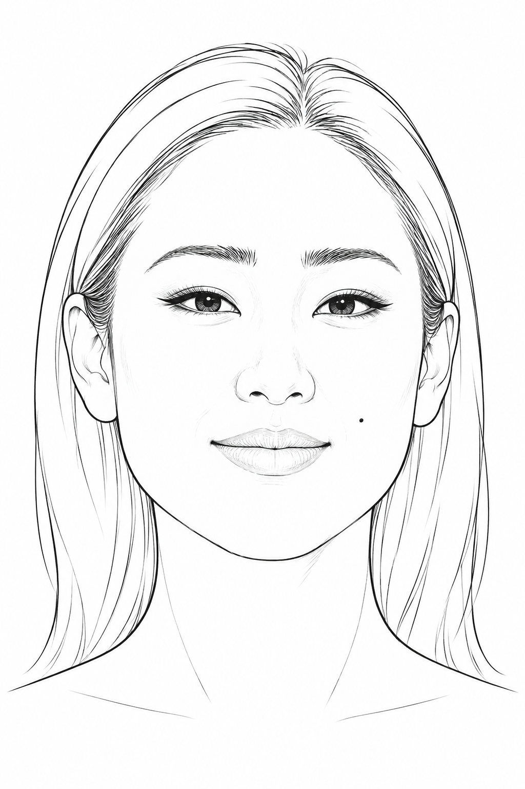

<!-- GENERATED from version JSON, sidecar metadata and personal corrections. Do not edit this reading copy. -->
# 巩俐 面貌线稿｜颧侧较宽、饱满面颊、舒展下颌，细长眼裂，鼻翼舒展、唇形饱满；长发轮廓及脸侧小痣保留。

[返回画廊总览](../../docs/gallery.md) · [版本与来源记录](case.json)

案例编号：`case-face-references-commons-gong-li-line-9e210fce53ab` · 版本：`v1`

版本说明：首次收录

资料类型：图片参考 · 复核状态：已复核

## 检索说明

检索状态：`confirmed`
检索标题：巩俐 面貌线稿｜颧侧较宽、饱满面颊、舒展下颌，细长眼裂，鼻翼舒展、唇形饱满；长发轮廓及脸侧小痣保留。
检索描述：巩俐 面貌线稿｜颧侧较宽、饱满面颊、舒展下颌，细长眼裂，鼻翼舒展、唇形饱满；长发轮廓及脸侧小痣保留。
检索别名：巩俐
检索关键词：面貌线稿、脸部参考、正面
有效标签：{"categories": ["人物与角色"], "scenes": ["角色头像"], "styles": ["面貌线稿", "脸部参考"]}

## 案例图片

### 图片 1 · 参考图

来源角色：`face_reference`

角色依据：用于角色设计的512 JPEG面貌起点


### 图片 2 · 输出效果图

来源角色：`line_master`

角色依据：生成式提线母版，供回查与重新派生规格



## 完整提示词

```text
将照片中占主体的唯一人物提炼为独立的平视正面面貌结构线稿，供虚构角色设计取用。保留这张照片的脸型长宽、颧侧、下颌和下巴，眉形、眉眼关系、眼裂大小与眼距、鼻梁鼻尖鼻翼、嘴宽和唇形的可辨差异。将照片的偏侧或倾斜姿态近似重建为端正正面，左右五官来自同一面貌。表情自然，嘴唇闭合，嘴角轻微上扬。人物年龄感依照片保留，五官保持自然成人比例。
只画完整脸、双耳、简洁头部外轮廓、颈和极少量肩线。眉眼鼻唇和脸侧边界用干净细黑线，鼻子和颊侧只用必要结构线，眼睛画眼睑、虹膜与瞳孔。全幅纯白底，脸部纯白，以轮廓和稀疏结构线表达。头发只用贴头的一条外轮廓与发际线表示，完整露出眉眼和两侧脸型。省略发束细丝、妆容纹理、睫毛密集刻画、肤色、灰阶、明暗、排线、摄影背景、首饰、帽子、服装细节、麦克风、其他人物和文字。
2:3竖幅，头位于画面中央，头部最高处上方保留约10%白色空间，完整显示双耳和下巴。纯单人面貌结构线描，无文字、logo、水印。
本张需特别保留的关系：较宽的颧侧与饱满面颊，舒展下颌，自然弧眉，细长眼裂、上眼睑弧度平顺，鼻尖圆润、鼻翼较舒展，嘴宽与饱满唇形。
```

[查看原始来源](https://commons.wikimedia.org/wiki/File:Gong_Li_Cannes_2016.jpg)
