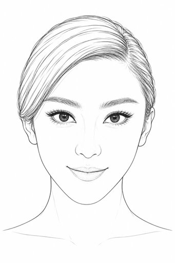
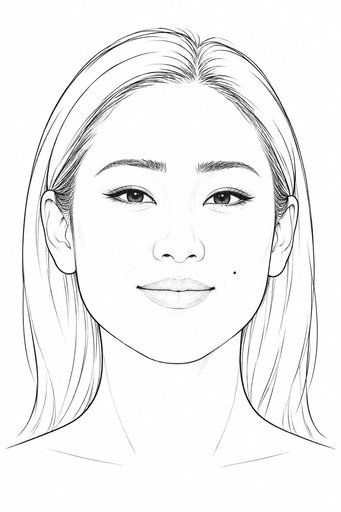
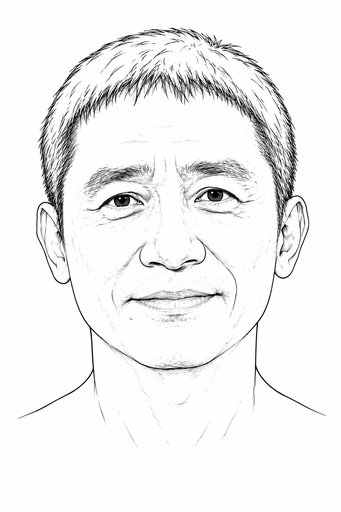

# 面貌线稿首批

三张线稿由许可明确的照片经 image_gen 近似重建正面，首批用于检索与资产设计取用。线稿提供面貌起点，角色、妆发和表现按当前设计形成；先看实际图片。

每条记录的 `image_index=0` 是长边512 JPEG，`image_index=1` 是提线母版。完整实际提示、源图对应和规格保存在详情与来源清单。

## 范冰冰

上半脸舒展、下颌收束、小下巴，较大杏仁眼，小鼻尖，清楚唇弓；侧分发型线仍较多。

- [线稿 v1](../cases/case-face-references-commons-fan-bingbing-line-c7f864849bf5/v1.md) · [来源照片 v1](../cases/case-face-references-commons-fan-bingbing-photo-946c0f218ee6/v1.md)
- 512 JPEG：23262 字节；作者 Georges Biard；[CC BY-SA 3.0](https://creativecommons.org/licenses/by-sa/3.0)。

## 巩俐

颧侧较宽、饱满面颊、舒展下颌，细长眼裂，鼻翼舒展、唇形饱满；长发轮廓及脸侧小痣保留。

- [线稿 v1](../cases/case-face-references-commons-gong-li-line-9e210fce53ab/v1.md) · [来源照片 v1](../cases/case-face-references-commons-gong-li-photo-12316cd82442/v1.md)
- 512 JPEG：26544 字节；作者 Georges Biard；[CC BY-SA 3.0](https://creativecommons.org/licenses/by-sa/3.0)。

## 梁朝伟

成熟男性，浓眉、窄长眼裂、较宽鼻翼、舒展嘴宽、偏薄上唇和较宽下颌；眼下与鼻唇沟纹理线偏多。

- [线稿 v1](../cases/case-face-references-commons-tony-leung-line-adf2120829bd/v1.md) · [来源照片 v1](../cases/case-face-references-commons-tony-leung-photo-b1ac890bf1b0/v1.md)
- 512 JPEG：27486 字节；作者 Runawaymo；[CC BY-SA 4.0](https://creativecommons.org/licenses/by-sa/4.0)。

## 使用与来源

[面貌参考方法](methods/face-references.md) · [来源与处理清单](../sources/face-references-commons/source-review.json) · [完整画廊](gallery.md)

照片与其提线衍生图按各自来源的同一 CC BY-SA 许可保存；作者、原文件页、许可链接和修改说明随记录保留。来源的人物权利提示按实际用途查阅。当前正面图是生成式近似重建，不能当作原生正面测量。头发与皱纹线仍可能影响后续造型，可在实际设计中调整取用范围。
