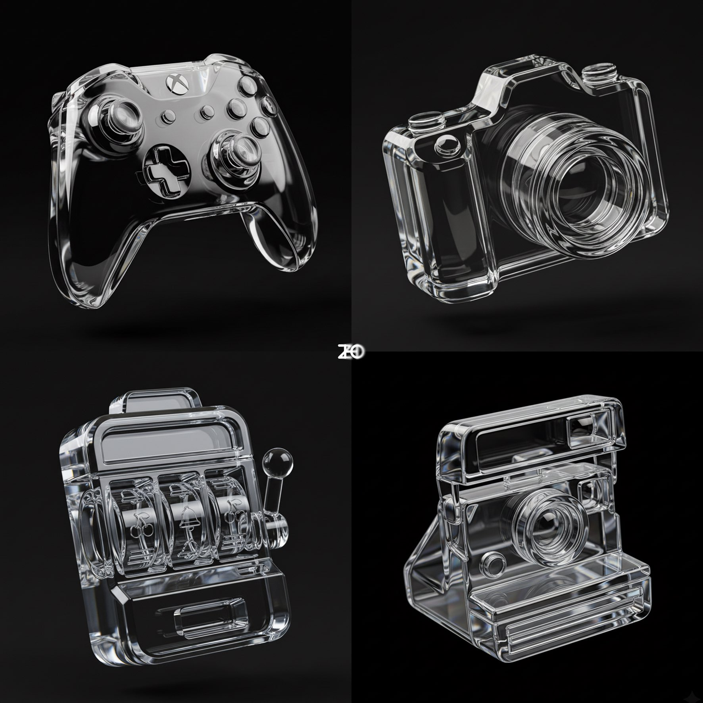
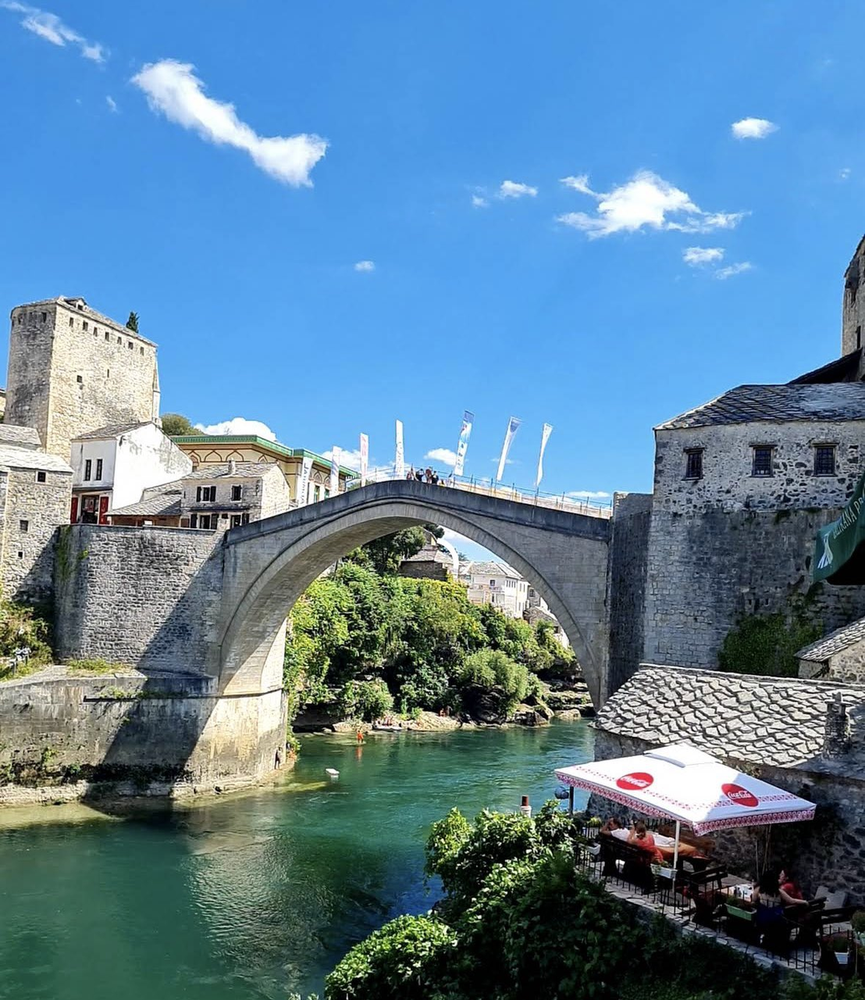
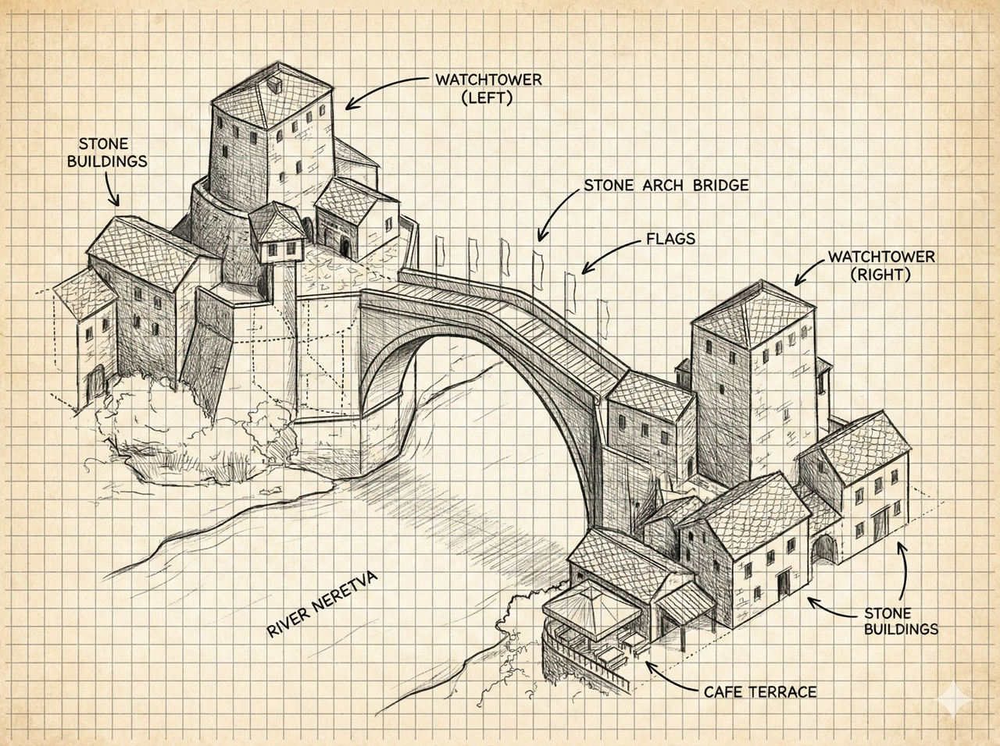
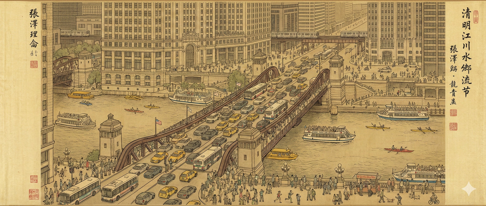
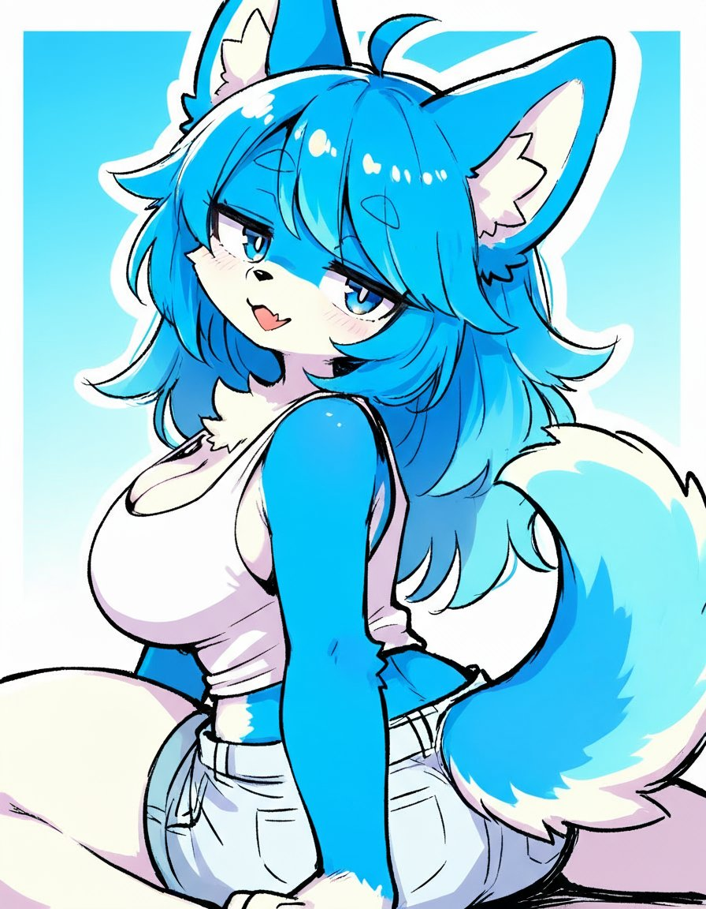
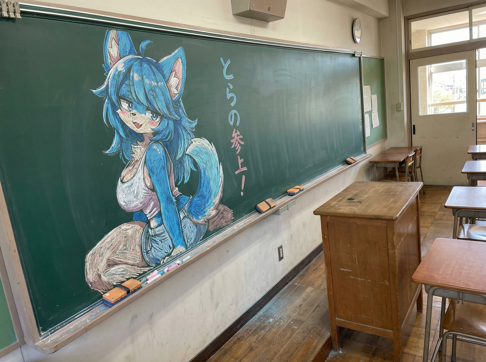
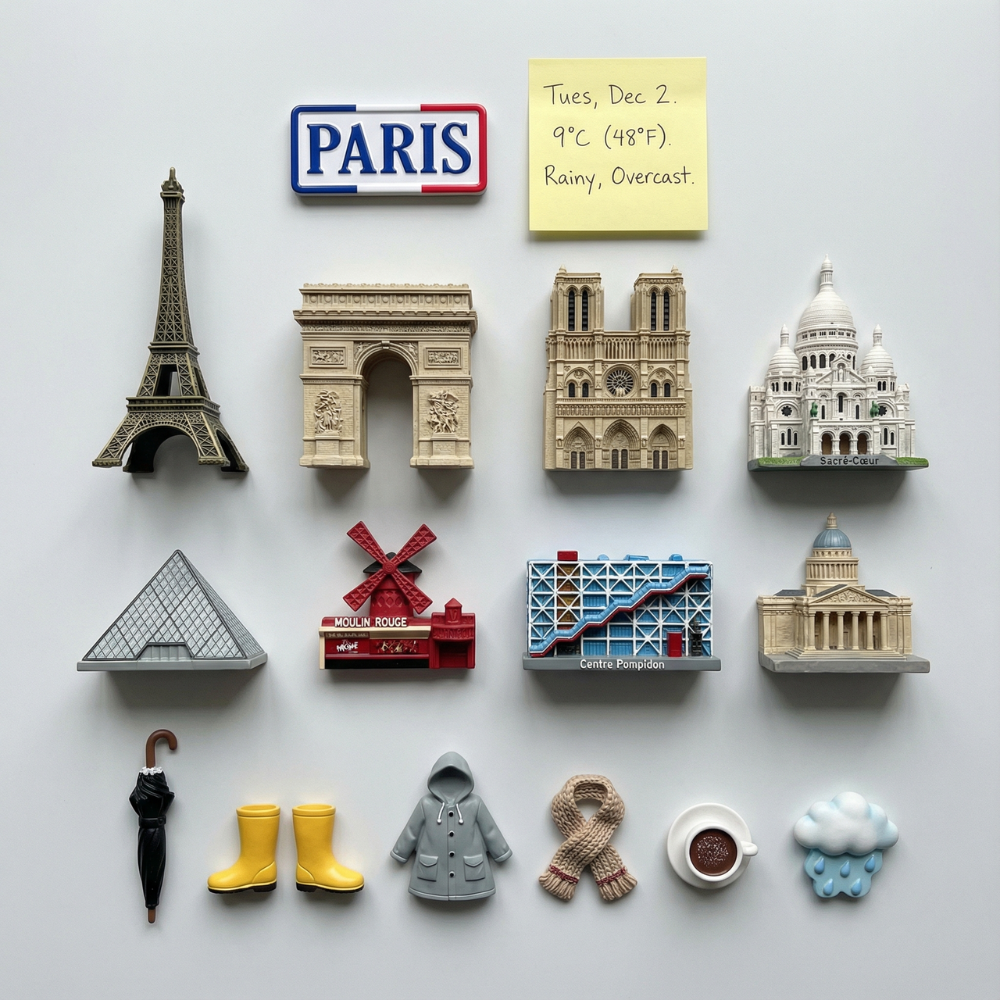
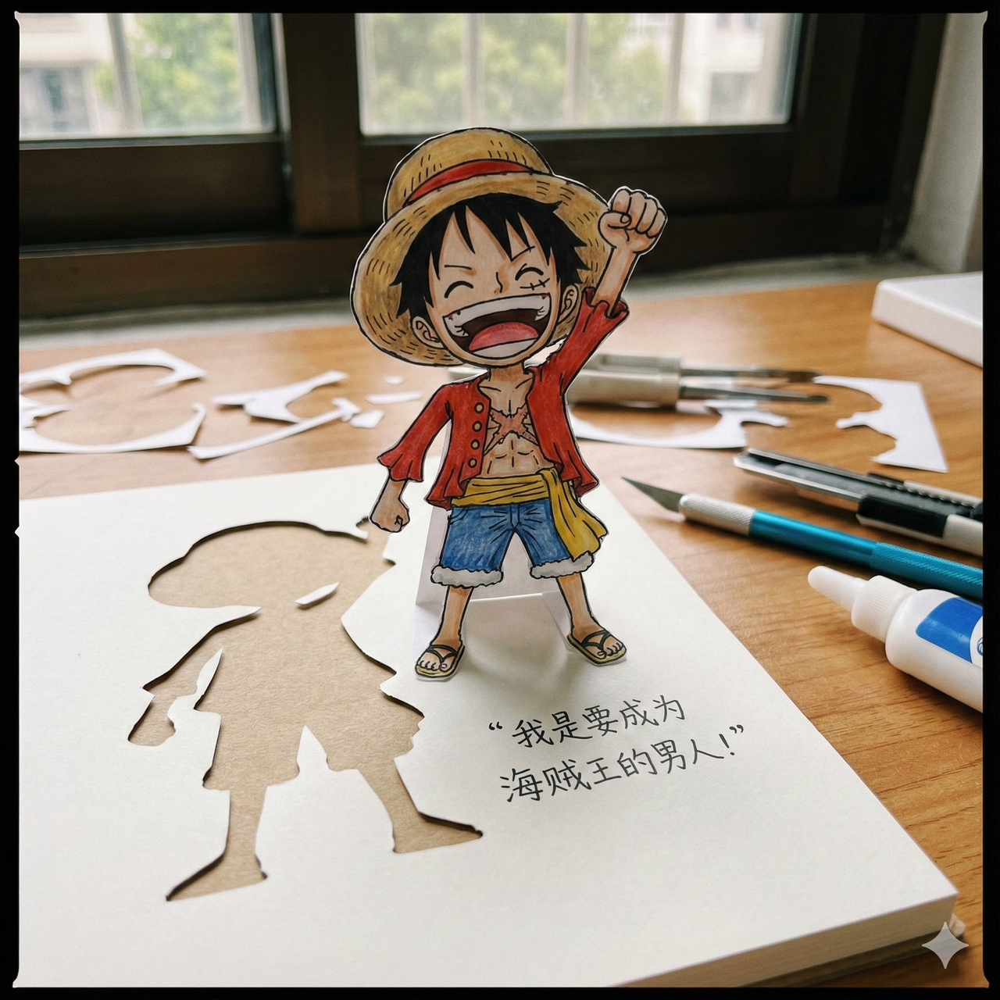

<!-- Generated by scripts/gallery.py; edit authoritative JSON, then rebuild. -->

# 全部资料 · 第 305 册

[画廊总览](gallery.md) | [上一册](gallery-part-304.md)

本册 11 条资料。标题链接固定到所示版本。

## 范冰冰 来源照片 · v1

- [范冰冰 来源照片 · v1](../cases/case-face-references-commons-fan-bingbing-photo-946c0f218ee6/v1.md) — case-face-references-commons-fan-bingbing-photo-946c0f218ee6

图片参考 · unknown

**已记录补充核查结果；以详情中的输入要求为准**

**参考图**


## 巩俐 面貌线稿｜颧侧较宽、饱满面颊、舒展下颌，细长眼裂，鼻翼舒展、唇形饱满；长发轮廓及脸侧小痣保留。 · v1

- [巩俐 面貌线稿｜颧侧较宽、饱满面颊、舒展下颌，细长眼裂，鼻翼舒展、唇形饱满；长发轮廓及脸侧小痣保留。 · v1](../cases/case-face-references-commons-gong-li-line-9e210fce53ab/v1.md) — case-face-references-commons-gong-li-line-9e210fce53ab

图片参考 · unknown

**已记录补充核查结果；以详情中的输入要求为准**

**参考图**


**输出示例图**


<details>
<summary>展开完整提示词</summary>

```text
将照片中占主体的唯一人物提炼为独立的平视正面面貌结构线稿，供虚构角色设计取用。保留这张照片的脸型长宽、颧侧、下颌和下巴，眉形、眉眼关系、眼裂大小与眼距、鼻梁鼻尖鼻翼、嘴宽和唇形的可辨差异。将照片的偏侧或倾斜姿态近似重建为端正正面，左右五官来自同一面貌。表情自然，嘴唇闭合，嘴角轻微上扬。人物年龄感依照片保留，五官保持自然成人比例。
只画完整脸、双耳、简洁头部外轮廓、颈和极少量肩线。眉眼鼻唇和脸侧边界用干净细黑线，鼻子和颊侧只用必要结构线，眼睛画眼睑、虹膜与瞳孔。全幅纯白底，脸部纯白，以轮廓和稀疏结构线表达。头发只用贴头的一条外轮廓与发际线表示，完整露出眉眼和两侧脸型。省略发束细丝、妆容纹理、睫毛密集刻画、肤色、灰阶、明暗、排线、摄影背景、首饰、帽子、服装细节、麦克风、其他人物和文字。
2:3竖幅，头位于画面中央，头部最高处上方保留约10%白色空间，完整显示双耳和下巴。纯单人面貌结构线描，无文字、logo、水印。
本张需特别保留的关系：较宽的颧侧与饱满面颊，舒展下颌，自然弧眉，细长眼裂、上眼睑弧度平顺，鼻尖圆润、鼻翼较舒展，嘴宽与饱满唇形。
```

</details>

## 巩俐 来源照片 · v1

- [巩俐 来源照片 · v1](../cases/case-face-references-commons-gong-li-photo-12316cd82442/v1.md) — case-face-references-commons-gong-li-photo-12316cd82442

图片参考 · unknown

**已记录补充核查结果；以详情中的输入要求为准**

**参考图**


## 梁朝伟 面貌线稿｜成熟男性，浓眉、窄长眼裂、较宽鼻翼、舒展嘴宽、偏薄上唇和较宽下颌；眼下与鼻唇沟纹理线偏多。 · v1

- [梁朝伟 面貌线稿｜成熟男性，浓眉、窄长眼裂、较宽鼻翼、舒展嘴宽、偏薄上唇和较宽下颌；眼下与鼻唇沟纹理线偏多。 · v1](../cases/case-face-references-commons-tony-leung-line-adf2120829bd/v1.md) — case-face-references-commons-tony-leung-line-adf2120829bd

图片参考 · unknown

**已记录补充核查结果；以详情中的输入要求为准**

**参考图**


**输出示例图**


<details>
<summary>展开完整提示词</summary>

```text
将照片中占主体的唯一人物提炼为独立的平视正面面貌结构线稿，供虚构角色设计取用。保留这张照片的脸型长宽、颧侧、下颌和下巴，眉形、眉眼关系、眼裂大小与眼距、鼻梁鼻尖鼻翼、嘴宽和唇形的可辨差异。将照片的偏侧或倾斜姿态近似重建为端正正面，左右五官来自同一面貌。表情自然，嘴唇闭合，嘴角轻微上扬。人物年龄感依照片保留，五官保持自然成人比例。
只画完整脸、双耳、简洁头部外轮廓、颈和极少量肩线。眉眼鼻唇和脸侧边界用干净细黑线，鼻子和颊侧只用必要结构线，眼睛画眼睑、虹膜与瞳孔。全幅纯白底，脸部纯白，以轮廓和稀疏结构线表达。头发只用贴头的一条外轮廓与发际线表示，完整露出眉眼和两侧脸型。省略发束细丝、妆容纹理、睫毛密集刻画、肤色、灰阶、明暗、排线、摄影背景、首饰、帽子、服装细节、麦克风、其他人物和文字。
2:3竖幅，头位于画面中央，头部最高处上方保留约10%白色空间，完整显示双耳和下巴。纯单人面貌结构线描，无文字、logo、水印。
本张需特别保留的关系：成熟男性的较宽面部与明确下颌、稍方的圆下巴，浓眉、窄长眼裂、内收上眼睑，较清楚的鼻梁与较宽鼻翼，舒展嘴宽与偏薄上唇、自然下唇。保留少量眼下和鼻唇沟结构线帮助表现成熟面貌。
```

</details>

## 梁朝伟 来源照片 · v1

- [梁朝伟 来源照片 · v1](../cases/case-face-references-commons-tony-leung-photo-b1ac890bf1b0/v1.md) — case-face-references-commons-tony-leung-photo-b1ac890bf1b0

图片参考 · unknown

**已记录补充核查结果；以详情中的输入要求为准**

**参考图**


## 水晶质感emoji · v1

- [水晶质感emoji · v1](../cases/case-picotrex-nano-banana-selected-pro-case13-d75720310f38/v1.md) — case-picotrex-nano-banana-selected-pro-case13-d75720310f38

风格参考 · nano-banana

**已记录补充核查结果；以详情中的输入要求为准**

实看为四格玻璃制品展示板，右下是拍立得相机。晶体透明、厚度、倒角和折射对应原词；图为黑背景而原词指定淡米白/浅灰背景，其他三格主体未给独立参数。按材质风格参考保存整个原图，不宣称四格均为这段相机prompt的逐字输出。

**输出示例图**



<details>
<summary>展开完整提示词</summary>

```text
一幅照片级真实、细节高度丰富的图像，主体是 [一台 3D 拍立得相机]，以清澈、抛光度极高的透明玻璃或水晶材质渲染而成。[机身具有明显的厚度与立体深度，经典拍立得相机的标志性造型——方正机身、前置镜头、顶部取景器、正面拍照按钮以及底部吐片槽——全部以简化却极为精确的几何结构呈现，使其无需任何图案就能一眼辨认]。所有边缘采用圆润倒角与光滑曲面处理，在光线下产生优雅的折射效果。相机略微倾斜摆放，仿佛漂浮在洁净无暇、无缝衔接的淡米白或极浅灰色棚拍背景上方。

照明为明亮、干净的专业棚拍光，重点突出玻璃材质的透明性、镜面反射与折射特性。机身倒角、吐片槽边缘与镜头圆环处呈现锐利而细腻的高光，凸显晶莹质感与奢华视觉。光线穿透玻璃机身内部时产生微妙的折射、光线弯曲与局部失真效果，在镜头厚度变化区、吐片槽内部与顶部取景器附近尤为明显，极大增强了逼真感与视觉冲击力。相机下方与稍偏后方落下一片柔和、漫散的阴影，使画面具有落地感却不破坏极简气质。

整体美学风格极简、现代、干净，呈现高端产品摄影与概念艺术渲染的视觉效果。画面焦点完全聚焦于玻璃拍立得相机晶莹剔透的材质表现与经典几何造型。影像整体为高调光感与浅景深处理，使拍立得相机保持绝对清晰的焦点，而背景柔和虚化，从而最大程度突出主体。
```

</details>

## 手绘等距图 · v1

- [手绘等距图 · v1](../cases/case-picotrex-nano-banana-selected-pro-case15-cab2a4c397d4/v1.md) — case-picotrex-nano-banana-selected-pro-case15-cab2a4c397d4

原图文案例 · nano-banana

**已记录补充核查结果；以详情中的输入要求为准**

输入为石拱桥街景照片，输出保留桥、河道和两岸石建筑并改为方格纸上手绘等距示意图。输入输出独立原图齐全；增加了文字标注与推断的不可见结构，不能当测绘准确性证明。

**输入参考图**



**输出示例图**



<details>
<summary>展开完整提示词</summary>

```text
绘制这条街道的手绘等距示意图
```

</details>

## 清明上河图风格图像 · v1

- [清明上河图风格图像 · v1](../cases/case-picotrex-nano-banana-selected-pro-case26-93d3d492fe3d/v1.md) — case-picotrex-nano-banana-selected-pro-case26-93d3d492fe3d

原图文案例 · nano-banana

**已记录补充核查结果；以详情中的输入要求为准**

实看为黄褐绢本长卷、桥梁现代车辆、建筑细线和河岸小人物，符合张择端风格及现代芝加哥重绘意图。未独立核验地理细节与题字；不声称是张择端真作。

**输出示例图**



<details>
<summary>展开完整提示词</summary>

```text
一幅气势恢宏、细节丰富的传统中国水墨彩绘手卷，绘于古旧绢本之上，完美地模仿了张择端名作《清明上河图》的艺术风格、笔法和散点透视。
中心场景：俯瞰熙熙攘攘的现代芝加哥河滨。画面焦点是巨大的钢制开启桥（杜萨布尔桥/密歇根大道桥），桥上车水马龙，无数汽车、黄色出租车和芝加哥交通管理局（CTA）公交车穿梭其间，所有景象均以精准的传统笔触描绘。
环境细节：下方的芝加哥河上，现代建筑风格的游船、水上出租车和皮划艇穿梭其间。河岸两侧林立着风格各异的芝加哥摩天大楼（形似箭牌大厦和论坛报大厦），以传统的“界画”建筑绘画技法绘制而成。背景中可见高架铁路和正在行驶的“L”型列车。
人类活动：河滨步道和桥边的人行道上挤满了数百个身着现代休闲服饰的小人。他们有的在慢跑，有的在用智能手机拍照，有的在街头小吃摊（热狗摊）前排队，有的在遛狗。整个场景细节丰富，略显杂乱，并以柔和的复古大地色调呈现。
```

</details>

## 黑板粉笔画 · v1

- [黑板粉笔画 · v1](../cases/case-picotrex-nano-banana-selected-pro-case28-b00e453b047a/v1.md) — case-picotrex-nano-banana-selected-pro-case28-b00e453b047a

原图文案例 · nano-banana

**已记录补充核查结果；以详情中的输入要求为准**

输入蓝色兽耳角色插画与输出教室黑板粉笔画均已保存并实看；主要姿势、头发、配色相符，加入侧拍透视、讲台和粉笔颗粒。输出文字为日语近义表达，并非逐字中文“虎来了！”，服装细节有重绘；此例验证图文对应及完整性，不作为严格字符保持成功例。

**输入参考图**



**输出示例图**



<details>
<summary>展开完整提示词</summary>

```text
将这幅插图用粉笔在黑板上进行绘画，使用彩色粉笔，从某个角度拍摄了黑板，场景来自日本教室，黑板靠墙放置，老师的桌子在前面，插图旁边用粉笔写着“虎来了！”。
```

</details>

## 城市冰箱贴 · v1

- [城市冰箱贴 · v1](../cases/case-picotrex-nano-banana-selected-pro-case35-794ac658a42b/v1.md) — case-picotrex-nano-banana-selected-pro-case35-794ac658a42b

原图文案例 · nano-banana

**已记录补充核查结果；以详情中的输入要求为准**

实看巴黎地标微缩磁贴整齐排列，含PARIS纪念牌、天气便签和雨具；对应原词指定的城市地标与天气平铺设计。城市占位符示例为Paris，保存源模板原样；图中日期与天气只是源样例内容，并非当前气象事实。

**输出示例图**



<details>
<summary>展开完整提示词</summary>

```text
展示一张清晰的俯视图，照片内容为 [城市名称] 地标建筑的3D磁贴，磁贴需整齐排列成平行线和直角，呈小山状。这些磁贴需为逼真的微缩模型。在顶部中央放置一个印有城市名称的纪念磁贴，以及一张手写便签，上面写着温度和天气状况。将与当日天气相关的物品融入到小山状装饰中。所有物品不得重复。
```

</details>

## 人物纸艺剪纸 · v1

- [人物纸艺剪纸 · v1](../cases/case-picotrex-nano-banana-selected-pro-case51-a2cb6bcef393/v1.md) — case-picotrex-nano-banana-selected-pro-case51-a2cb6bcef393

原图文案例 · nano-banana

**已记录补充核查结果；以详情中的输入要求为准**

实看路飞纸艺小人、站立折脚、镂空纸轮廓、木桌和手写经典台词，与原词相符。原prompt保留姿势/台词占位符，图是源作者选定内容的示例，不补造具体生成参数；角色及商标权不由源库许可转让。

**输出示例图**



<details>
<summary>展开完整提示词</summary>

```text
[角色] = 路飞

木质书桌上摆着一件充满奇趣的手工纸艺作品：将手绘的卡通 [角色] 从纸上剪下，折叠成一个立体的站立小人偶。[角色] [姿势]。在它身旁的纸面上，不仅有那个留下的空白剪影，还手写着一句它的 [经典台词]。

画面比例：1080 x 1080
```

</details>

